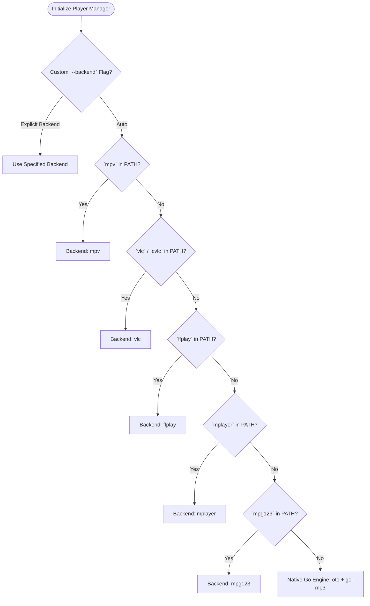

# Audio Engine & Player Architecture 🎵

The audio playback subsystem in `halpradio` is designed for maximum compatibility across macOS, Linux, and BSD systems. It uses a **multi-backend fallback architecture** with automatic binary detection, supplemented by a zero-dependency native Go audio driver.

---

## 🎧 Multi-Backend Audio Engine

When `halpradio` launches, [`player.NewManager`](../pkg/player/player.go) inspects the host system to auto-detect installed CLI media players.



### Supported Backends Summary:

| Backend | Binary | Executable Flags | Supported Codecs | Notes |
|---|---|---|---|---|
| **MPV** *(Recommended)* | `mpv` | `--no-video --no-terminal --ytdl=no --load-unsafe-playlists=no --sub-auto=no --audio-file-auto=no --cover-art-auto=no --volume=N` | MP3, AAC, OGG, FLAC, HLS, Opus | Best streaming stability & lowest latency. |
| **VLC / CVLC** | `vlc` / `cvlc` | `-I dummy --quiet --gain=N` | MP3, AAC, OGG, FLAC, HLS | Wide codec support, lightweight in dummy mode. |
| **FFplay** | `ffplay` | `-nodisp -loglevel quiet -volume N` | MP3, AAC, OGG, FLAC | Part of ffmpeg suite. |
| **MPlayer** | `mplayer` | `-quiet -volume N` | MP3, AAC, OGG | Traditional Linux media player. |
| **MPG123** | `mpg123` | `-q -g N` | MP3 | Lightweight MP3 decoder. |
| **Native Go** | Built-in | Direct PCM stream to host audio | MP3 | Zero external binary dependencies required. Full live DSP rack. |

---

## 🔊 Native Go Audio Backend (`oto/v3` + `go-mp3`)

When no external media CLI is installed on the system, `halpradio` gracefully switches to its **native Go player engine**:
- **HTTP Streamer**: Initiates an HTTP GET request to the radio stream URL with customizable user agents.
- **MP3 Decoder**: Streams incoming bytes through `github.com/hajimehoshi/go-mp3`, wrapped by `pkg/player/mp3safe`, which skips ID3v2 tags only up to 1 MiB and turns decoder panics into a playback error.
- **DSP Rack**: Runs the decoded PCM through the equalizer, crossfeed, lo-fi and loudness stages (see [DSP Rack](#-dsp-rack-equalizer-loudness-normalizer--crossfeed)).
- **Audio Output**: Feeds the processed 16-bit PCM audio samples directly into hardware sound drivers via `github.com/ebitengine/oto/v3`.

> [!NOTE]
> The native Go player handles MP3 streams out of the box. For AAC/AAC+ streams, installing `mpv` or `ffmpeg` is recommended.

### Untrusted stream input

Station URLs and stream bytes come from catalogs and remote servers, so the player treats them as untrusted:

- **Where a station came from decides whether it may reach your network.** Stations you add yourself (the add-station form, `halpradio stations add`, a URL typed on the command line) may point at loopback or LAN addresses, such as a Snapcast or Icecast box at home. Stations from the bundled catalog, catalog updates, RadioBrowser, SomaFM or a listening party may not: they are dropped at import if their host is `localhost`, an IP literal in a private or reserved range, or a local-only name (`.local`, `.lan`, `.internal`, `.home.arpa`, a single-label name), and the player refuses them again at play time.
- **Restricted addresses** are loopback, RFC 1918, link-local (including the `169.254.169.254` metadata service), CGNAT `100.64.0.0/10`, `0.0.0.0/8`, `192.0.0.0/24`, benchmarking `198.18.0.0/15`, documentation ranges, multicast, `240.0.0.0/4` and broadcast, IPv6 unique-local, link-local, site-local and multicast, and IPv6 forms that carry an IPv4 address (IPv4-mapped, NAT64 `64:ff9b::/96`, 6to4 `2002::/16`), which are judged by that address. IPv4-compatible `::/96`, `64:ff9b:1::/48` and Teredo `2001::/32` are always restricted.
- **One HTTP policy** (`pkg/player/streamnet`) is used by the native player, the ICY listener and the pure-Go fingerprint capture: `http`/`https` only and at most 5 redirects. For a station that may not reach your network, every address actually dialled is checked, so a name that resolves (or later re-resolves) to a private address is refused. For your own stations the first connection decides: a LAN station plays, but a public station cannot redirect into your LAN.
- **No proxy** for the Go connections, deliberately: the address check must see the real destination, and a proxy would hide it. `HTTP_PROXY`/`HTTPS_PROXY` are therefore ignored by the native player, the ICY listener and the Go fingerprint fallback.
- **External players** (mpv, VLC, ffplay, mplayer, mpg123) and ffmpeg resolve hosts and follow redirects, playlist entries and HLS segments themselves. For a station that may not reach your network, halpradio first resolves the host and refuses to start the player if any answer is a restricted address. It then starts a **stream guard proxy** (`pkg/player/streamproxy`) on `127.0.0.1` for that playback only, and the player sends every request through it:
  - The proxy dials through the same strict check as the native player, so a redirect, an m3u/pls entry, an HLS segment or a re-resolved name that points at a restricted address gets `403`. https goes through it as `CONNECT`, and only to the host and port asked for.
  - It accepts only `GET`, `HEAD` and `CONNECT` with an absolute `http` URL, never follows redirects itself, strips hop-by-hop and `Proxy-*` headers, limits header size and concurrent connections, times out idle connections, and cannot reach itself or loopback.
  - It requires a random Basic credential made for each playback. The proxy address and credential are passed in the player's environment (`http_proxy`, `https_proxy` and their upper-case forms), so they do not show in the process list. Inherited `no_proxy`, `all_proxy` and other proxy variables are removed for that player, so a proxy you configured yourself is not used for these stations.
  - mpg123's own HTTP client never sends the credential, so for these stations mpg123 runs with `--network curl` and needs `curl` installed. If curl is missing, playback fails instead of going direct. Settings in your own `~/.curlrc` (for example `noproxy`) still apply to it.
  - VLC also gets `--http-proxy`, so its credential is visible in the process list while it plays. VLC and mplayer have not been tested against the proxy.
  - If the proxy cannot start, the station is refused with an error. halpradio never falls back to a direct connection. The proxy stops when playback stops.
  - Stations you added yourself get no proxy and keep your proxy settings, so LAN stations still play.
  - Shoutcast `ICY 200 OK` status lines are rewritten to `HTTP/1.0 200 OK` on the way through.
- **Protocols**: ffplay and ffmpeg run with `-protocol_whitelist http,https,tcp,tls,crypto,httpproxy`, and mpv gets the same list through `--stream-lavf-o` and `--demuxer-lavf-o`, for every station. A playlist entry such as `gopher://` or `file://` is therefore refused. A `tcp://` entry would get past the proxy, but mpv does not open it because of `--load-unsafe-playlists=no`, and the ffmpeg HLS demuxer only fetches `http`/`https` segments. The fingerprint capture also refuses any URL that is not `http`/`https`.
- **mpv** is started with `--ytdl=no` (no `yt-dlp` helper), `--load-unsafe-playlists=no` and no automatic loading of subtitle, audio or cover files next to the URL. The URL always follows `--`.
- **Decoder failures** (malformed MP3, oversized or more than eight leading ID3 tags) end in an error status with a message; they never crash the app.
- **Error messages and the debug log** (`--debug`): a URL quoted in a status message has control characters removed and is capped at 200 characters. Stream URLs are logged without user info, query string or fragment, backend command lines are logged the same way, and logged text has newlines and control characters collapsed.

---

## 📻 Real-time ICY Metadata Extraction

Many Internet Radio stations (Icecast / Shoutcast) broadcast live song and artist information inside the HTTP stream via **ICY metadata**.

`halpradio` implements a dedicated, non-blocking ICY reader goroutine in [`startICYListener`](../pkg/player/player.go):

1. **Request Header**: Sends `Icy-MetaData: 1` HTTP request header.
2. **Metadata Interval Parsing**: Reads the `Icy-Metaint: N` response header, which specifies the exact byte interval between metadata chunks.
3. **Chunk Extraction**: Reads `N` audio bytes, followed by 1 byte indicating metadata length `L * 16`.
4. **Stream Title Parsing**: Extracts `StreamTitle='Artist - Song Title';` from the metadata payload.
6. **Sanitization**: Passes the extracted `StreamTitle` through `radio.SanitizeTrackTitle()` to remove ads, URLs, jingles, and radio promo noise before updating the TUI.

```
[ Audio Bytes (N) ] [ Meta Length (1 B) ] [ StreamTitle='Artist - Track'; ] [ Audio Bytes (N) ] ...
       │
       ▼
[ Sanitizer: Strips Ads / URLs / Jingles ]
       │
       ▼
[ Dispatches TrackInfo to UI Model ]
```

---

## 🧼 Dirty Metadata Sanitizer (`pkg/radio/sanitizer.go`)

Radio stations frequently inject disruptive promotional text, sponsor messages, jingles, and website URLs into their ICY metadata streams. `halpradio` sanitizes incoming stream titles automatically:

- **Ad & Sponsor Removal**: Strips promo phrases such as `Buy on somafm.com`, `Ad: ...`, `Sponsored by ...`, `Commercial Break`, `Support this station`.
- **URL & Slogan Cleansing**: Strips web addresses (`http://...`, `www....`), station slogans, frequency call signs (`104.5 FM`), and composite noise (`//`, `|`, `:::`, `***`).
- **MusicBrainz Sanity Checks**: Validates candidate track titles against recording schemas to eliminate false positive song names.
- **Deduplication**: Prevents redundant notification spam when metadata fluctuations only alter minor spacing or casing.

---

## 🔍 Acoustic Stream Fingerprinting (`pkg/player/fingerprint/`)

For stations that stream music without ICY track metadata, or when ICY tags are inaccurate, `halpradio` provides on-demand and automatic acoustic audio fingerprinting.

```mermaid
flowchart TD
    UserPress["User presses 'I' or Auto-Identify triggered"] --> CaptureBuffer["Capture 5s Audio Stream (PCM)"]
    
    CaptureBuffer --> CheckFFmpeg{"`ffmpeg` available?"}
    CheckFFmpeg -->|Yes| FFmpegCapture["Sample via ffmpeg: 11025Hz Mono S16LE"]
    CheckFFmpeg -->|No| GoCapture["Pure-Go Decoder: HTTP GET + go-mp3"]
    
    FFmpegCapture --> GenerateFP["Generate Chromaprint Subfingerprint"]
    GoCapture --> GenerateFP
    
    GenerateFP --> CheckFpcalc{"`fpcalc` available?"}
    CheckFpcalc -->|Yes| FpcalcCLI["Compute via fpcalc CLI"]
    CheckFpcalc -->|No| GoSTFT["Pure-Go STFT Spectral Subfingerprinter"]
    
    FpcalcCLI --> CheckCache{"Cached in LRU?"}
    GoSTFT --> CheckCache
    
    CheckCache -->|Cache Hit| ReturnResult["Return Cached Track Result"]
    CheckCache -->|Cache Miss| AcoustIDQuery["Query AcoustID API v2 (/v2/lookup)"]
    
    AcoustIDQuery --> MBQuery["Enrich with MusicBrainz Metadata"]
    MBQuery --> CacheResult["Store in TTL Cache (10m)"]
    CacheResult --> ReturnResult
    ReturnResult --> TUI["Display [✨ Identified (94%)] + Update History + Yank 'y'"]
```

### Key Subsystems:
1. **Audio Capture ([`pkg/player/fingerprint/capture.go`](../pkg/player/fingerprint/capture.go))**:
   - Streams 5 seconds of audio buffer converted to 11,025 Hz mono 16-bit PCM WAV.
   - Prefers host `ffmpeg` CLI when installed (network protocols only); falls back to pure-Go HTTP streaming and MP3 decoding if external binaries are missing.
2. **Fingerprint Engine ([`pkg/player/fingerprint/fingerprint.go`](../pkg/player/fingerprint/fingerprint.go))**:
   - Generates Chromaprint-compatible compressed subfingerprints.
   - Prefers `fpcalc` CLI; falls back to a pure-Go 16-band STFT (Short-Time Fourier Transform) subfingerprint generator.
3. **Lookup Client ([`pkg/player/fingerprint/client.go`](../pkg/player/fingerprint/client.go))**:
   - Queries `https://api.acoustid.org/v2/lookup` with open key `v8pQ6oyB` (or custom key in `config.yaml`).
   - Retrieves recording metadata, artist credits, album releases, and release year.
   - Reads at most 1 MiB of response and strips control, bidi and zero-width characters from every returned string before display.
4. **LRU Cache ([`pkg/player/fingerprint/cache.go`](../pkg/player/fingerprint/cache.go))**:
   - Thread-safe in-memory cache with 10-minute TTL eviction, avoiding duplicate queries for the same song.
5. **UI Integration**:
   - Renders visual confidence bar (`████████░ 94%`) in the player bar.
   - Identified tracks populate the History tab (`H`) with a `✨` star badge.
   - System clipboard yank (`y`) automatically copies identified tracks.

---

## 🎚 DSP Rack: Equalizer, Loudness Normalizer & Crossfeed

Press `E` to open the **Graphic Equalizer & DSP Rack**. The rack is pure Go (`pkg/player/dsp/`) and runs on float PCM between the MP3 decoder and `oto`, so the native backend needs no extra binaries. Settings are saved to `~/.config/halpradio/dsp.yaml` when the modal closes and are restored at startup.

Signal chain, in order:

```
decoder → 10-band EQ → lo-fi cassette → crossfeed → R128 normalizer → lookahead limiter → oto
```

| Stage | What it does |
|---|---|
| **10-band graphic EQ** | RBJ peaking biquads at 32, 64, 125, 250, 500, 1k, 2k, 4k, 8k and 16k Hz (Q 1.41, ±12 dB). Presets: Flat, Bass Boost, Vocal Clarity, Electronic, Acoustic, Deep Focus and Lo-Fi Tape. Bands at 0 dB and bands above 0.45 × sample rate are skipped. |
| **Lo-fi cassette** | 90 Hz high-pass, 6.5 kHz low-pass, `tanh` tape saturation and a quiet hiss floor (about -56 dBFS). |
| **Binaural crossfeed** | The Bauer / Chu Moy bs2b algorithm (700 Hz, 4.5 dB): each ear gets a low-passed, slightly delayed copy of the other channel, which softens hard-panned mixes on headphones. |
| **EBU R128 normalizer** | ITU-R BS.1770-4 K-weighted loudness over 400 ms blocks every 100 ms, with the -70 LUFS absolute gate and -10 LU relative gate, integrated over a 10 s sliding window. The gain moves towards `loudness_target_lufs` (default -14) at 30 dB/s for the first 3 s of a station, then slowly: 3 dB/s down and 1.5 dB/s up. Individual beats therefore cannot pump the gain. Loudness is measured before the gain, so there is no feedback loop. During silence the gain is held. Boost is capped at +12 dB. |
| **Lookahead limiter** | Runs with the normalizer. A 5 ms lookahead with a smoothed gain envelope and 120 ms release keeps true peaks under -1 dBFS without clicks. |

With everything off (Flat, all toggles off) the rack is bypassed and the samples pass through bit-for-bit. The full rack runs at well over 20× real time on one core (`go test -bench ChainFullRack ./pkg/player/dsp`). This leaves plenty of headroom, so audio frames are not dropped.

### Backend support

| Backend | DSP support | How |
|---|---|---|
| **Native Go** | ✅ Live | In-process `dsp.Chain` wrapped around the decoder |
| **MPV** | ✅ Live | FFmpeg `lavfi` graph passed with `--af=@halpradio:lavfi=[…]` and updated live over the JSON IPC socket (`set_property af`) |
| **FFplay** | ⏭ Next station | Same `lavfi` graph passed with `-af`; changes apply when the next station starts |
| **VLC / CVLC / MPlayer / MPG123** | ❌ Unavailable | The modal shows a warning and suggests native, mpv or ffplay |

External backends use FFmpeg's own filters (`equalizer`, `highpass`, `lowpass`, `asoftclip`, `crossfeed`, `loudnorm`), so the sound is close to the native rack but not identical.

---

## 🎛️ Volume & Mute Controls

Volume changes dynamically calculate backend-specific volume parameters:
- **MPV**: `0` to `100` volume argument.
- **VLC**: Gain multiplier `0.00` to `1.00`.
- **FFplay / MPG123**: Scale integer volume arguments.
- **Native Go**: Adjusts gain via `oto.Player.SetVolume(float64)`.

Muting preserves the previous volume level and toggles zero gain output across all backends.

