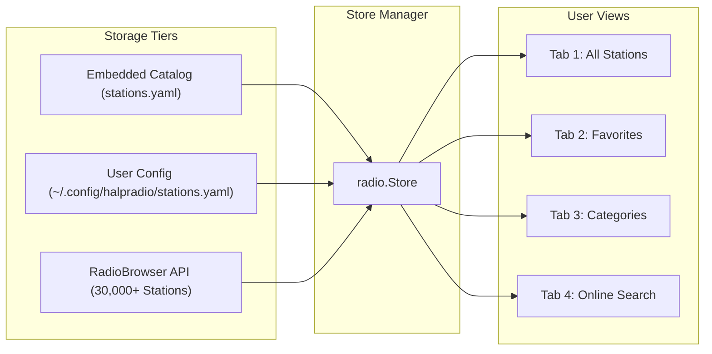

# Station Catalog & RadioBrowser Integration 📻

`halpradio` provides a flexible station management pipeline that combines bundled curated stations, custom local stations, online search via RadioBrowser API, and 1-click station sharing via GitHub PRs.

---

## 🗂️ Station Storage Architecture

Station entries are managed by [`radio.Store`](../pkg/radio/store.go) across three distinct storage tiers:



### 1. Bundled & Cached Catalog (`stations.yaml` & `catalog_cache.yaml`)
- **Embedded Release Baseline**: Included directly in the binary release via Go embed (`//go:embed stations.yaml`).
- **Dynamic Remote Sync (Aggressive Caching & Lightweight Check)**:
  - On launch, `halpradio` checks for updated catalog releases in the background.
  - **Zero Server Load**: Checks are throttled to once per 24 hours (`catalog_cache_ttl_hours: 24`). Within TTL, **zero network requests** are sent.
  - **Lightweight 304 Conditional Checks**: When checking, conditional HTTP headers (`If-None-Match` with ETag and `If-Modified-Since`) are sent. If the remote catalog has not changed, the server returns `304 Not Modified` with 0 body bytes.
  - **Strict Validation**: the downloaded catalog is untrusted until it passes every check below; only then is it written to `~/.config/halpradio/catalog_cache.yaml` (atomically, mode `0600`):
    - the update URL must be `https`; redirects may not downgrade to `http` or lead to a loopback or private address;
    - the body may be at most 5 MB (a larger body is refused, never truncated);
    - every entry must pass the station validation described under [Station validation](#-station-validation), and at least one must;
    - a catalog whose `catalog_version` is lower than the cached one, or whose `Last-Modified` date is older, is refused as a rollback;
    - a catalog with fewer than half as many valid stations as the cached one is refused as implausible;
    - when a catalog signing key is built in (see below), `stations.yaml.sig` next to the catalog must carry a valid signature.
  - **Loading the cache**: the cached catalog is checked again when it is loaded: its signature (when a key is built in), every entry, and its size relative to the embedded catalog (a cache with fewer than half as many stations is ignored).
  - **Signing (not active yet)**: the updater supports an Ed25519 signature over the exact bytes of `stations.yaml`, published base64-encoded as `stations.yaml.sig` beside it. It is enforced only once the project builds its public key into `radio.CatalogSigningPublicKey`; until then the checks above are the protection. When a key is set, an unsigned or wrongly signed catalog is refused and an unsigned cache is ignored.
  - **CLI Update**: Run `halpradio update-stations` or `halpradio -update-catalog` to manually trigger an update.

### 2. Local Custom Stations (`~/.config/halpradio/stations.yaml`)
- Created or edited interactively using the **Add Station** dialog (`a` key binding).
- Persisted locally on the user's computer.
- Merged seamlessly into the main station list without modifying git workspace files.
- A station added without an ID gets the first free `custom-N` ID, so deleting a station never causes a later one to overwrite another.
- A local station always wins over a catalog station with the same ID: a catalog update cannot repoint it.

### 3. Favorites (`~/.config/halpradio/favorites.json`)
- Toggled on any station with the `f` key binding.
- Stores complete station metadata, ensuring online RadioBrowser stations saved as favorites remain accessible across app restarts even when offline.
- The stored copy wins over a catalog station with the same ID, so a catalog update cannot change the stream URL of a station you favourited. To pick up a catalog change for a favourite, unfavourite and favourite it again.
- The file is validated on load like every other source: entries that fail validation, or whose key does not match their `id`, are dropped.

---

## 📄 Station YAML Schema

All station files (`stations.yaml` and `~/.config/halpradio/stations.yaml`) adhere to the following schema:

```yaml
stations:
  - id: station-unique-id
    name: "Station Name"
    url: "https://stream.example.com/live.mp3"
    genre: "Lofi / Chill"
    country: "US"           # 2-letter ISO country code (e.g. US, GB, SE, DE, FR, JP)
    bitrate: 128            # Stream bitrate in kbps (e.g. 128, 192, 320)
    codec: "MP3"            # MP3, AAC, OGG, etc.
    homepage: "https://example.com"
```

## 🛡️ Station validation

Every station passes one gate, `radio.SanitizeStation`, whatever its source: the embedded catalog, the downloaded catalog and its cache, your local `stations.yaml`, `favorites.json`, RadioBrowser results, SomaFM, the **Add Station** dialog and `halpradio stations add`. Entries that fail are dropped, never repaired, and a note is recorded (`Store.LoadWarnings`).

- **`id`**: 1 to 96 characters from `A-Z a-z 0-9 . _ : -`, starting with a letter or digit. Invalid IDs are refused rather than rewritten, so two stations can never be shortened into the same ID.
- **`url`**: an absolute `http://` or `https://` URL with a host, at most 2048 bytes, with no user name or password, no spaces and no control characters. `file://`, `javascript:` and other schemes are refused.
- **`name`**: required; it and every other text field are stripped of terminal control sequences (escape sequences, C1 controls, bidi overrides, zero-width characters) and capped (name 120 characters, genre 80, other fields 60).
- **`homepage`**: kept only when it is a valid `http`/`https` URL; otherwise it is cleared.
- **`bitrate`**: outside 0 to 100000 it becomes 0.
- Later entries that repeat an ID already seen in the same source are dropped.

The catalog may also carry an optional top-level `catalog_version:` integer. The updater refuses a catalog whose version is lower than the cached one; raise it with every published catalog change.

---

## 🌐 RadioBrowser API Integration

`halpradio` includes a built-in client ([`radio.RadioBrowserClient`](../pkg/radio/radiobrowser.go)) that connects to the public [RadioBrowser API](https://www.radio-browser.info/):

- **Endpoint**: `https://de1.api.radio-browser.info/json/stations/search`
- **Features**:
  - Top-voted global station listings.
  - Live keyword search by station name, tag, or country.
  - Automatic fallback stream URL resolution.
  - Stream metadata normalization (bitrate, codec, country flags).
  - Station IDs are `rb-` plus the full RadioBrowser station UUID. (Older versions cut the UUID to 17 characters; favourites saved with such an ID still work, but they will not be matched with the same station in new search results.)
  - Responses larger than 4 MB are refused and at most 500 results are kept.

Press `Tab` to navigate to the **Online Search** tab, type any genre or query (e.g., `synthwave`, `bbc`, `jazz`, `japan`), and press `Enter` to query thousands of live streams instantly.

---

## 🐙 GitHub PR Snippet Export Workflow (`p` Key)

To make expanding the public station catalog effortless for the community, `halpradio` includes an automatic snippet exporter:

1. Select any station in your list (or create a new station via `a`).
2. Press `p`.
3. `halpradio` automatically formats the station as clean YAML and writes it directly to your system clipboard (using platform utilities like `pbcopy` on macOS, `xclip`/`xsel` on Linux, or Windows clipboard).
4. Paste the snippet directly into [`stations.yaml`](../stations.yaml) and open a Pull Request!

```yaml
# Generated by pressing 'p' in halpradio
  - id: lofi-girl-radio
    name: "Lofi Girl Radio"
    url: "https://stream.example.com/lofi.mp3"
    genre: "Lofi"
    country: "FR"
    bitrate: 128
    codec: "MP3"
```
